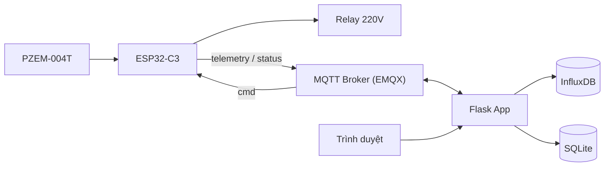

# ⚡ Energy Monitor

Hệ thống web quản lý tập trung nhiều đồng hồ điện **PZEM-004T** gắn **ESP32-C3**:
thu thập số đo real-time qua **MQTT**, lưu time-series trên **InfluxDB**, hiển thị
và cảnh báo qua web, đồng thời **đóng/cắt nguồn 220V từ xa** qua relay.


## ✨ Tính năng

- Theo dõi real-time điện áp, dòng điện, công suất, điện năng, tần số, hệ số công suất.
- Quản lý nhiều **site** (địa điểm) và **thiết bị**, trạng thái online/offline (MQTT LWT).
- **Điều khiển relay** bật/tắt tải có bước xác nhận, theo dõi `cmd/ack` để biết lệnh đã thực thi.
- Cấu hình **ngưỡng cảnh báo** theo thiết bị (quá công suất, mất kết nối, auto-cutoff).
- Lịch sử công suất và lịch sử đóng/cắt relay.
- Script **giả lập thiết bị** để test end-to-end khi chưa có phần cứng.

## 🏗️ Kiến trúc



Một app Flask duy nhất, render HTML bằng Jinja2 (không cần Node.js/build step).
MQTT subscriber chạy nền trong cùng tiến trình.

## 📡 MQTT topics

| Topic | Hướng | Mô tả |
|---|---|---|
| `energy/{device_id}/telemetry` | thiết bị → server | Số đo định kỳ (5–10s) |
| `energy/{device_id}/status` | thiết bị → server | Online/offline + trạng thái relay (retained + LWT) |
| `energy/{device_id}/cmd` | server → thiết bị | Lệnh bật/tắt relay |
| `energy/{device_id}/cmd/ack` | thiết bị → server | Xác nhận lệnh theo `request_id` |

Ví dụ payload `telemetry`:

```json
{ "ts": 1735689600, "voltage": 220.3, "current": 1.42, "power": 312.5,
  "energy": 128.44, "frequency": 50.0, "power_factor": 0.98, "relay": true }
```

## 🚀 Cài đặt & chạy

Yêu cầu: Python 3.10+, InfluxDB 2.x và MQTT broker (EMQX/Mosquitto) đang chạy.

```bash
git clone https://github.com/HuYingTran/energy-monitor.git
cd energy-monitor
cp .env.example .env          # điền INFLUX_TOKEN / INFLUX_ORG / INFLUX_BUCKET, MQTT_HOST...

cd backend
python3 -m venv venv
./venv/bin/pip install -r requirements.txt
./venv/bin/python run.py      # http://localhost:8000
```

Giả lập thiết bị (publish telemetry liên tục, phản hồi lệnh relay):

```bash
cd backend
./venv/bin/python scripts/simulate_devices.py
```

### Biến môi trường (`.env`)

| Biến | Mặc định | Ý nghĩa |
|---|---|---|
| `SQLITE_PATH` | `energy_monitor.db` | File SQLite (trong `backend/`) |
| `INFLUX_URL` | `http://localhost:8086` | Địa chỉ InfluxDB |
| `INFLUX_ORG` / `INFLUX_BUCKET` / `INFLUX_TOKEN` | | Thông tin InfluxDB |
| `MQTT_HOST` / `MQTT_PORT` | `localhost` / `1883` | MQTT broker |

## 🖥️ Các trang web

| Đường dẫn | Chức năng |
|---|---|
| `/devices` | Danh sách thiết bị, trạng thái online/relay, thêm thiết bị |
| `/devices/<id>` | Số đo real-time (tự refresh 5s), biểu đồ công suất, nút bật/tắt relay, lịch sử relay |
| `/sites` | Quản lý site |
| `/alerts` | Cấu hình ngưỡng & lịch sử cảnh báo |
| `/health` | Health check |

## 📁 Cấu trúc thư mục

```
energy-monitor/
├── .env.example
├── docs/DESIGN.md            # tài liệu thiết kế chi tiết
└── backend/
    ├── run.py                # entrypoint (port 8000)
    ├── requirements.txt
    ├── scripts/simulate_devices.py
    └── app/
        ├── __init__.py       # create_app()
        ├── config.py         # đọc .env (pydantic-settings)
        ├── models.py         # Site, Device, AlertRule, Alert, RelayEvent
        ├── database.py       # SQLAlchemy + SQLite
        ├── influx_client.py  # đọc/ghi InfluxDB
        ├── mqtt_service.py   # MQTT subscriber nền + gửi lệnh relay
        ├── tariff.py         # ước tính tiền điện theo bậc thang EVN
        ├── routes.py         # các trang web
        ├── templates/        # Jinja2
        └── static/
```

## 🗺️ Roadmap

- [x] Web app khung: Flask + SQLite + InfluxDB, MQTT ingest, điều khiển relay
- [ ] Firmware ESP32-C3 đọc PZEM-004T qua Modbus
- [ ] Rule engine: tự bắn cảnh báo + auto-cutoff
- [ ] Báo cáo chi phí điện (đã có hàm ước tính theo biểu giá bậc thang EVN)
- [ ] Bảo mật & deploy: MQTT TLS/ACL, đăng nhập người dùng

> ⚠️ **An toàn điện:** relay đóng/cắt điện 220V — chọn relay/SSR đúng dòng định mức,
> cách ly mạch điều khiển 3.3V với mạch lực, và xác định rõ hành vi fail-safe khi
> thiết bị mất kết nối. Xem thêm [docs/DESIGN.md](docs/DESIGN.md).
