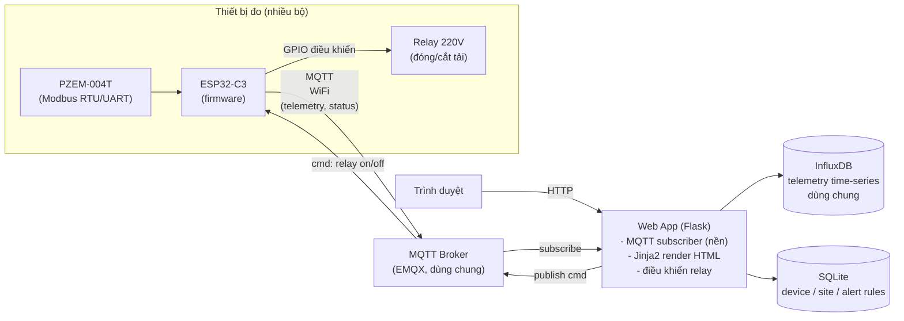

# Energy Monitor — Hệ thống quản lý đồng hồ điện PZEM-004T

Ứng dụng web đơn giản quản lý tập trung nhiều đồng hồ đo điện PZEM-004T gắn
ESP32-C3, thu thập dữ liệu real-time qua MQTT, lưu trữ trên InfluxDB, hiển
thị/cảnh báo qua web. Mỗi thiết bị còn có **relay đóng/cắt nguồn 220V**, cho
phép điều khiển bật/tắt tải từ xa (thủ công hoặc tự động theo rule).

> File này là tài liệu sống (living doc) — cập nhật liên tục khi ý tưởng/quyết
> định thay đổi trong quá trình xây dựng.

## 1. Mục tiêu

- Theo dõi real-time điện áp, dòng điện, công suất, điện năng tiêu thụ của
  nhiều đồng hồ PZEM-004T tại nhiều vị trí/site.
- Xem lịch sử tiêu thụ theo giờ/ngày, ước tính chi phí điện.
- Cảnh báo khi quá tải, mất kết nối thiết bị, hoặc tiêu thụ bất thường.
- Quản lý fleet thiết bị: trạng thái online/offline.
- Điều khiển đóng/cắt nguồn 220V từ xa qua relay, thủ công hoặc tự động theo
  ngưỡng (VD tự cắt khi quá công suất).

## 2. Kiến trúc tổng thể

Một app Python duy nhất (Flask), không tách frontend/backend riêng — server
render HTML trực tiếp (Jinja2), không cần build step hay Node.js.



## 3. Thành phần hệ thống

| Thành phần | Công nghệ | Vai trò |
|---|---|---|
| Firmware | ESP32-C3 (Arduino/ESP-IDF) | Đọc PZEM-004T qua Modbus RTU, publish MQTT, điều khiển relay 220V |
| Message broker | EMQX (container dùng chung trên máy) | Trung chuyển dữ liệu real-time, LWT phát hiện mất kết nối |
| Web app | **Flask + Jinja2** (Python) | 1 app duy nhất: subscribe MQTT (nền), ghi/đọc InfluxDB + SQLite, render trang, gửi lệnh relay |
| Time-series DB | **InfluxDB** (container dùng chung trên máy) | Lưu dữ liệu đo (voltage, current, power, energy...) |
| Relational DB | **SQLite** (file cục bộ) | Site, device registry, ngưỡng cảnh báo, lịch sử đóng/cắt relay |

Không dùng Docker cho app — chạy trực tiếp bằng Python venv. InfluxDB và MQTT
broker (EMQX) là container có sẵn, dùng chung với các project khác trên máy.

## 4. Giao thức MQTT — cấu trúc topic

```
energy/{device_id}/telemetry     # ESP32 publish định kỳ (5-10s)
energy/{device_id}/status        # online/offline + trạng thái relay (retained + LWT)
energy/{device_id}/cmd           # server -> thiết bị (relay on/off)
energy/{device_id}/cmd/ack       # thiết bị phản hồi lệnh
```

Payload `telemetry` (JSON):

```json
{
  "ts": 1735689600,
  "voltage": 220.3,
  "current": 1.42,
  "power": 312.5,
  "energy": 128.44,
  "frequency": 50.0,
  "power_factor": 0.98,
  "relay": true
}
```

Payload `status` (retained, để app biết ngay trạng thái relay khi mở dashboard,
không cần chờ chu kỳ telemetry tiếp theo):

```json
{ "online": true, "relay": true, "last_seen": 1735689600 }
```

Payload `cmd` — điều khiển relay:

```json
{ "action": "relay_set", "value": false, "request_id": "abc123" }
```

Thiết bị publish lại `cmd/ack` với cùng `request_id` để backend xác nhận lệnh
đã thực thi (quan trọng vì đây là điều khiển tải điện thật, cần biết chắc lệnh
có thành công hay không, không chỉ "gửi rồi coi như xong").

### Lưu ý an toàn khi điều khiển relay 220V

- **Fail-safe khi mất WiFi/MQTT**: firmware cần quyết định rõ hành vi khi mất
  kết nối — giữ nguyên trạng thái relay hiện tại (khuyến nghị cho tải thông
  thường) hoặc về trạng thái an toàn định trước (VD tắt) tùy loại tải.
- **Debounce lệnh**: chặn spam bật/tắt liên tục (rơle cơ khí có tuổi thọ đóng
  cắt giới hạn, dễ hỏng nếu đóng/cắt quá nhanh).
- **Xác nhận trên UI**: thao tác cắt nguồn có bước confirm trước khi gửi lệnh.
- **Chọn relay/module phù hợp tải**: rơle cơ khí hay SSR (solid-state relay)
  cần chọn đúng dòng định mức tải thực tế, có cách ly an toàn giữa mạch điều
  khiển 3.3V (ESP32) và mạch 220V.

## 5. Data model InfluxDB

- **Measurement**: `telemetry`
- **Tags** (indexed, dùng để filter): `device_id`, `site_id`
- **Fields** (giá trị đo): `voltage`, `current`, `power`, `energy`, `frequency`, `power_factor`, `relay` (bool)

## 6. Data model SQLite (`backend/app/models.py`)

- `sites` — địa điểm/tòa nhà
- `devices` — device_id, tên, site_id, trạng thái online, trạng thái relay hiện tại
- `alert_rules` — device_id, loại ngưỡng (power_max, offline_timeout...), giá trị, **auto_cutoff**
- `alerts` — lịch sử cảnh báo đã bắn ra
- `relay_events` — lịch sử đóng/cắt relay: device_id, thời điểm, nguồn lệnh (user/rule/auto), kết quả ack

## 7. Các trang web chính

- **`/devices`** — danh sách thiết bị (trạng thái online, relay) + form thêm thiết bị
- **`/devices/<id>`** — chi tiết: giá trị real-time (V/A/W/kWh, tự refresh 5s),
  lịch sử công suất, **nút bật/tắt relay có confirm**, lịch sử đóng/cắt
- **`/sites`** — danh sách + thêm site
- **`/alerts`** — cấu hình ngưỡng cảnh báo theo thiết bị, lịch sử cảnh báo

## 8. Chạy dev

InfluxDB và EMQX dùng chung container có sẵn trên máy (không thuộc project
này, không cần khởi động). App chạy trực tiếp bằng Python venv.

```bash
cd backend
python3 -m venv venv
./venv/bin/pip install -r requirements.txt
./venv/bin/python run.py          # http://localhost:8000
```

Copy `.env.example` thành `.env` ở thư mục gốc trước khi chạy, điền
`INFLUX_TOKEN`/`INFLUX_ORG`/`INFLUX_BUCKET` thật của instance InfluxDB dùng
chung.

Giả lập thiết bị khi chưa có phần cứng thật (publish telemetry MQTT liên tục):

```bash
cd backend
./venv/bin/python scripts/simulate_devices.py
```

## 9. Roadmap

- [x] **Giai đoạn 1 — Web app khung**: Flask + SQLite (device/site/alert) +
      InfluxDB (telemetry), MQTT ingest + điều khiển relay
- [ ] **Giai đoạn 2 — Firmware**: đọc PZEM-004T qua Modbus, publish MQTT thật
      từ ESP32-C3
- [ ] **Giai đoạn 3 — Rule engine**: tự động bắn alert + auto_cutoff khi vi
      phạm ngưỡng (hiện mới lưu được rule, chưa có worker đánh giá)
- [ ] **Giai đoạn 4 — Chi phí điện**: biểu giá + ước tính tiền điện
- [ ] **Giai đoạn 5 — Bảo mật & deploy**: MQTT TLS/ACL, auth user, deploy production

## 10. Câu hỏi còn cần chốt

- Số lượng thiết bị dự kiến ban đầu và mục tiêu scale (chục / trăm / nghìn)?
- Deploy tự host (VPS) hay dùng cloud managed?
- Cách tính chi phí điện: biểu giá bậc thang EVN hay giá cố định do người dùng nhập?
